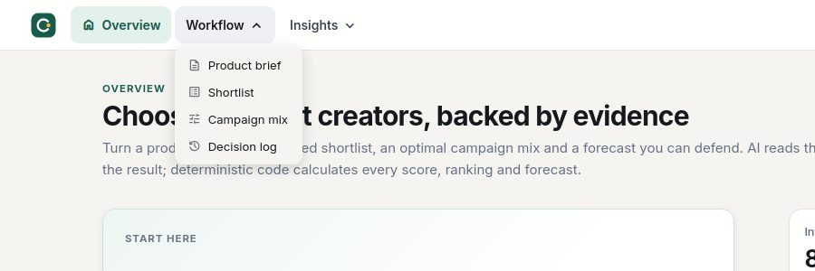
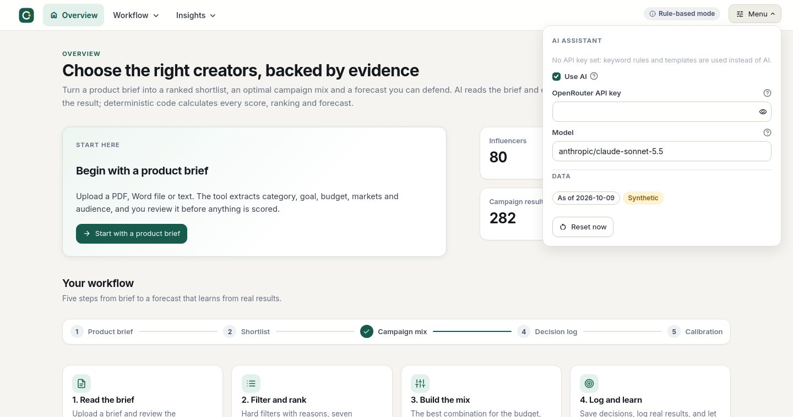
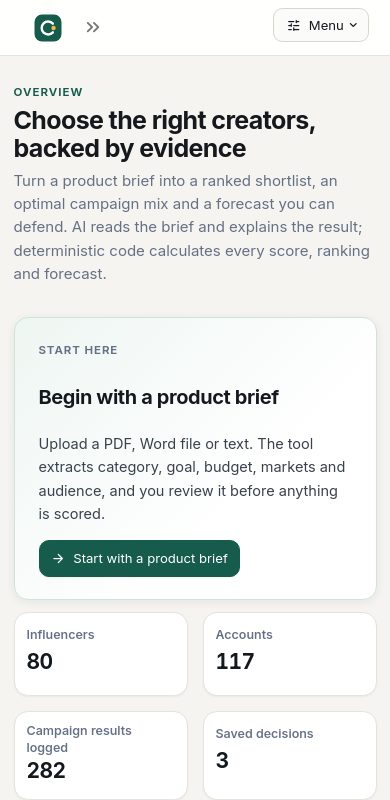

# Design system

The interface is built for analysts who compare many numbers and defend a decision: calm, dense where it has to be, with
the answer first and the controls beside it. Everything below lives in three files: `core/theme.py` (tokens and CSS),
`core/components.py` (HTML building blocks) and `core/tables.py` (one formatter for every data table). Pages only compose
them, so the look stays consistent.

## Navigation and menu

Navigation is a header bar (`st.navigation(position="top")`): Overview, a Workflow dropdown (Product brief, Shortlist, Campaign mix,
Decision log) and an Insights dropdown (Explorer, Calibration, Forecast model). URLs are unchanged. On the right of the header,
`ui.chrome()` pins an AI status chip and a **Menu** popover with the AI settings (use AI, OpenRouter key, model), data information and the
database reset. There is no sidebar on desktop; on phones Streamlit folds the header navigation into a drawer.

## Tables

Every plain table goes through `core/tables.py`, so tables read the same everywhere:

| Problem in a raw dataframe | What the formatter does |
|---|---|
| database names (`price_eur`, `usage_rights_months`) | sentence-case labels with units ("Fee (EUR)", "Usage rights (months)") |
| bare numbers (`15000`, `0.192`) | thousands separators, whole percentages, `0.87×` multipliers, score bars |
| ISO timestamps | real dates and `2026-10-20 07:26` |
| `1`/`0`, `None` | Yes/No and a dash |
| `plant_based_food`, `tiktok` | `plant based food`, `TikTok` |

Rules are by column name, with per-call overrides (`formats`, `widths`, `ratio`, `hide`, `order`). The ranking and mix tables are hand-configured
because they need selection and score bars; they use the same formats.

## Principles

1. **Answer first.** Results (the mix, the ranking) open each page. Controls sit in a sticky left rail, not above the answer.
2. **Show state.** Active filters are chips, workflow progress is a stepper, data problems are coloured chips and cards.
3. **One component per job.** Status is always a chip, grouping is always a card, empty is always the same empty state.
4. **Numbers are first-class.** Tabular figures, KPI cards with room for full labels, ranges instead of single values.
5. **Native where it matters.** Inputs, buttons, tables and metrics stay native Streamlit widgets (behaviour, accessibility and tests
   unchanged). They are restyled by CSS, not replaced.

## Tokens

| Token | Value | Use |
|---|---|---|
| Canvas / surface | `#F5F4F0` / `#FFFFFF` | page background / cards, inputs, charts |
| Ink / muted | `#15191E` / `#667085` | text / secondary text |
| Primary | `#165B4C` (hover `#0F4A3D`, soft `#E3F1EC`) | actions, selection, focus ring |
| Success / warning / danger / info | `#17803D` / `#8F5B00` / `#B42318` / `#1D4ED8` with tinted backgrounds | status only |
| Data palette | `#1B7F6B #3F5BD0 #E0932B #D2553F #7A5AA6 #2A9DB5 #8A8F98` | charts and the seven criteria |
| Type | Inter (bundled in `static/fonts`, OFL licence), 15 px base | tabular numerals for all figures |
| Radius / elevation | 10 px controls, 14 px cards / three shadow levels | |

Semantic chart colours (`GOOD`, `BAD`, `WARN`) are defined explicitly in `core/charts.py` and never taken from palette positions.

## Components (`core/components.py`)

`page_header`, `stepper` (completion derived from real state), `chips`, `section`, `step_header`, `empty_state`,
`profile_header`, `health_card`, `tiles`, `kv`, `hero_title`, `panel_title`, `bullet_card`. All text is HTML-escaped.
Layout helpers in `core/ui.py`: `header` (title plus stepper), `card` (bordered white surface with a deterministic key).

## Layout patterns

| Pattern | Used on |
|---|---|
| Rail plus content (sticky controls left, results right) | Shortlist (weights), Campaign mix (optimizer) |
| Editor plus live summary (summary sticks while you scroll the form) | Product brief |
| Active-filter chips plus an "Edit filters" popover | Shortlist |
| Master-detail | Decision log |
| Numbered step narrative | Forecast model |

## States

Hover, active, `:focus-visible` (3 px ring), disabled, selected (nav, tabs, table rows), loading (`st.spinner`, `st.status`),
empty (`empty_state`), success/warning/error (tinted alerts with icons), and a `prefers-reduced-motion` override.

## Responsive behaviour

| Width | Behaviour |
|---|---|
| above 1100 px | full layout, sticky rails |
| 1000 px and below | rail layouts stack below the header |
| 900 px and below | two-column grids wrap to 50 %, stepper shows only the current label |
| 640 px and below | single column, KPI cards stay two per row, header navigation becomes a drawer |

## Maintaining it

* The stylesheet is injected with `st.markdown(..., unsafe_allow_html=True)`. `st.html` strips a leading `<style>` and inline `<svg>`,
  so icons are CSS masks (`ic-ico-<name>`).
* Selectors rely on Streamlit's `data-testid` attributes (for example `stMetric`, `stTopNavLink`, `stTextInputRootElement`).
  They were verified on Streamlit 1.65. After a major Streamlit upgrade, run the app and check inputs, tabs and the header first.
* Charts get an explicit white canvas in `core/charts.py`, because Streamlit's chart theme would otherwise paint its own background.
* Cards are addressed by key (`card-1`, `card-2`, `rail_*`, `hero_*`) because a bordered container has no wrapper element of its own.
* `tests/test_theme.py` fails if the stylesheet stops rendering (a bare `%` in the CSS template once broke every page).
